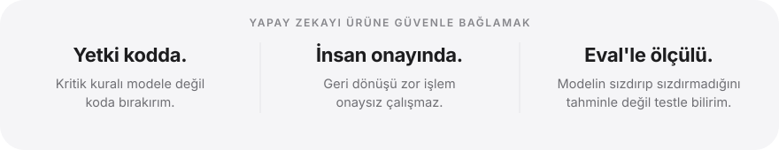

<picture>
  <source media="(prefers-color-scheme: dark)" srcset="assets/baslik-dark.svg">
  
</picture>

  <a href="https://twin-core.netlify.app/mas"><b>Portfolyo</b></a>&nbsp;&nbsp;·&nbsp;&nbsp;<a href="https://www.linkedin.com/in/mehmet-ali-sevin%C3%A7-2a8521254/"><b>LinkedIn</b></a>&nbsp;&nbsp;·&nbsp;&nbsp;<a href="https://jollin.com.tr/j/"><b>Jollin</b></a>

 

<picture>
  <source media="(prefers-color-scheme: dark)" srcset="assets/ilkeler-dark.svg">
  
</picture>

  

<h3 align="center">Öne çıkan projeler</h3>

  <a href="https://github.com/sevincmehmet/org-tree-asistani"><picture><source media="(prefers-color-scheme: dark)" srcset="assets/kart-org-tree-dark.svg"></picture></a>
  <a href="https://github.com/sevincmehmet/pano"><picture><source media="(prefers-color-scheme: dark)" srcset="assets/kart-pano-dark.svg"></picture></a>

  <a href="https://github.com/sevincmehmet/mini-erp"><picture><source media="(prefers-color-scheme: dark)" srcset="assets/kart-mini-erp-dark.svg"></picture></a>
  <a href="https://github.com/sevincmehmet/smart-plug-app"><picture><source media="(prefers-color-scheme: dark)" srcset="assets/kart-smart-plug-dark.svg"></picture></a>

 

<h3 align="center">Kullandıklarım</h3>

  <b>Arayüz</b>&nbsp;&nbsp;React · Next.js · TypeScript · Zustand · Redux · Tailwind · Radix UI · MUI 
  <b>Mobil &amp; masaüstü</b>&nbsp;&nbsp;React Native · Expo · Electron 
  <b>Öğreniyorum</b>&nbsp;&nbsp;.NET · EF Core · Google ADK · Python · eval

  Projelerimi Claude Code ile planlayıp paralel ajanlara bölerek geliştiriyor, her parçayı test ederek birleştiriyorum.

